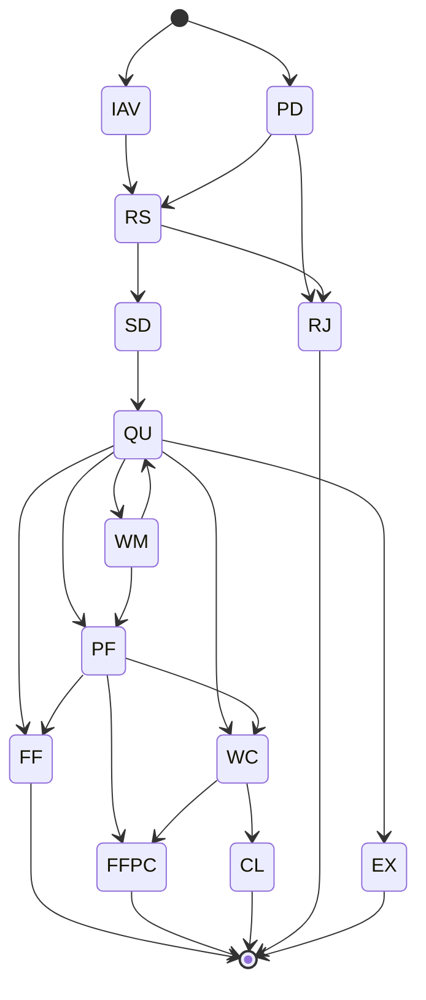

# Order Status Flow (Luồng trạng thái của lệnh)

Source: https://developers.ssi.com.vn/docs/api-reference/appendix/order-status-flow

## Overview

Every order placed through the FastConnect API moves through a lifecycle of states.
`order.place` / `order.amend` / `order.cancel` return a fast acknowledgement (`PD`);
the real terminal result arrives via the WebSocket `TRADING` channel
(`order.{accountNo}` topic), so subscribing is mandatory.

State diagram image: https://developers.ssi.com.vn/images/order-status-flow.png

## Status table

| # | Code | Name | Description |
|---|------|------|-------------|
| 1 | `PD` | Pending | Order accepted into the system (equity order). |
| 2 | `RS` | Ready to Send | Order ready to be sent to the exchange. |
| 3 | `SD` | Sent to Exchange | Order sent to the exchange (session orders). |
| 4 | `QU` | Queue in Exchange | Order queued at the exchange awaiting match. |
| 5 | `WA` | Waiting Approval | Order awaiting approval. |
| 6 | `FF` | Fully Filled | Entire quantity matched. **End state.** |
| 7 | `PF` | Partially Filled | Part of the quantity matched; remainder still queued. |
| 8 | `FFPC` | Fully Filled Partially Cancelled | Partially matched, remainder cancelled. **End state.** |
| 9 | `WM` | Waiting Modify | Awaiting modification (price or quantity). |
| 10 | `WC` | Waiting Cancel | Awaiting cancellation. |
| 11 | `CL` | Cancelled | Order cancelled successfully. **End state.** |
| 12 | `RJ` | Rejected | Order rejected (not eligible, bad parameters...). **End state.** |
| 13 | `EX` | Expired | Order expired or rejected by the exchange. **End state.** |
| 14 | `IAV` | PreSessionOrder | Pre-session (PS) order placed before trading hours, waiting for session open. |
| 15 | `SOI` | PreSessionStopOrder | Stop order placed before trading hours. |
| 16 | `PAS` | WaitingApprovalStopOrder | Stop order awaiting approval. |

## Transition details

### New order

1. On a place-order request the system records the order as:
   - `PD` (Pending) for a regular equity order
   - `IAV` (PreSessionOrder) for a pre-session order
2. Order moves to `RS` (Ready to Send) when ready for the exchange.
3. If not eligible (insufficient margin, bad parameters, room violation...) → `RJ` (Rejected).
4. Order sent to exchange → `SD` (Sent to Exchange) → queued → `QU` (Queue in Exchange).

### Matching

- Full quantity matched → `FF` (Fully Filled). Terminal.
- Partial match → `PF` (Partially Filled); remainder stays queued.

### Modify

- From `QU` or `PF` the client may request a modification.
- Order moves to `WM` (Waiting Modify).
- On success the order returns to its previous state (`QU` or `PF`) with updated details.

### Cancel

- From `QU`: cancel → `WC` (Waiting Cancel) → `CL` (Cancelled). Terminal.
- From `PF`: cancel remainder → `WC` → `FFPC`. Terminal.

### Expiry

- Order rejected at the exchange → `EX` (Expired). Terminal.
- `PF` order that reaches end of validity → `FFPC`. Terminal.

### End states

| Code | Meaning |
|------|---------|
| `FF` | Fully matched — trade complete. |
| `FFPC` | Partially matched, remainder cancelled or expired. |
| `CL` | Fully cancelled. |
| `RJ` | Rejected up front. |
| `EX` | Expired or rejected by the exchange. |

## Related

- WebSocket order notifications: `order.{accountNo}` on channel `TRADING`
  (no wildcard `*`; account must belong to the API key).
- Portfolio notifications: `portfolio.{accountNo}` — derivatives accounts only (suffix 8).
